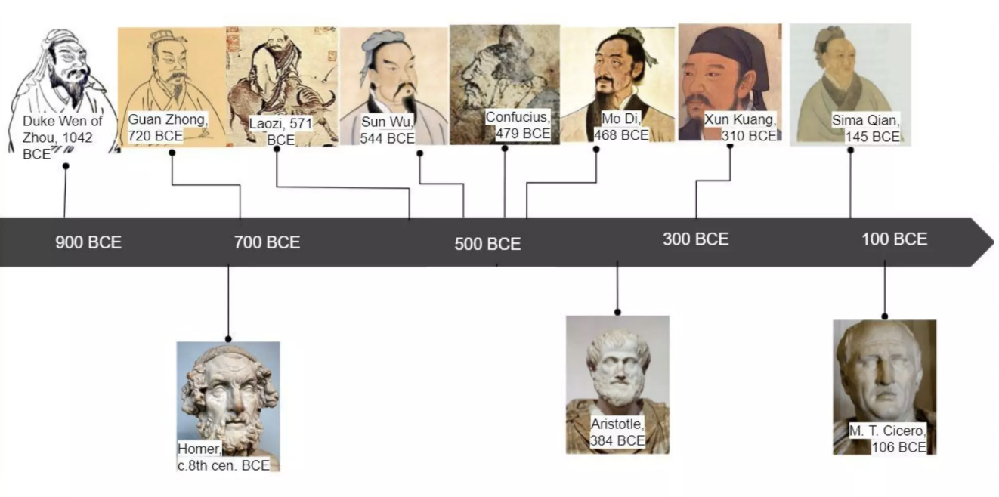

# Hundred Schools of Thought Advisory

A multi-agent learning project built on Python 3.12 and CrewAI. Submit a question, and four advisers—Confucianism, Legalism, Daoism, and Sunzi's Art of War—each offer advice grounded in their respective philosophical frameworks.

<div align="center">

</div>

## Features

- Four expert Agents with differentiated perspectives.
- CrewAI `Agent`, `Task`, `Crew`, and `Process.sequential` orchestration.
- Output in Markdown with each adviser using its own philosophical framework.
- CLI, Streamlit Web UI, foundational unit tests, Ruff configuration, and `.env.example`.

> Advisers are free to produce advice of any length using Markdown formatting (headings, bold, bullet points, etc.). The UI renders Markdown natively.

## Prerequisites

- Python 3.12
- `uv`
- Accessible model API with a valid API key

## Installation

```bash
uv sync --extra dev
cp .env.example .env
```

Edit `.env` to set your model provider and API key. For example, using an OpenAI-compatible endpoint:

```dotenv
API_KEY=api-key
MODEL=deepseek-v4-1-flash-economy-261017
BASE_URL=https://ark.cn-beijing.volces.com/api/v3
```

`MODEL` uses LiteLLM/CrewAI model identifiers. Different providers may require additional environment variables—consult the model and CrewAI documentation for details.

## Usage

```bash
uv run hundred-schools "In the early stages of a startup, should I prioritize growth or risk control?"
```

Or run interactively:

```bash
uv run hundred-schools
```

### Web UI

The Streamlit interface provides each school with its own conversation column,
supporting per-school toggles and broadcast questions to all enabled advisers.

```bash
uv sync --extra web
uv run hundred-schools-ui
```

A browser window will open automatically. Each adviser processes its response
progressively, so you see answers appear one by one rather than waiting for all.

## Development & Testing

```bash
uv run pytest
uv run ruff check .
uv run ruff format --check .
```

## Directory Structure

```text
.
├── CLAUDE.md
├── pyproject.toml
├── README.md
├── WEB_UI.md
├── .env.example
├── src/hundred_schools/
│   ├── agents/             # Expert Agent definitions
│   ├── crews/              # Crew orchestration
│   ├── tasks/              # Task definitions
│   ├── models/             # Pydantic output models
│   ├── config.py
│   ├── main.py             # CLI entry point
│   └── ui.py               # Streamlit Web UI + CLI entry point
└── tests/
```

## Design Boundaries

- CLI uses sequential execution; each of the four schools completes its advice task independently.
- Streamlit UI runs advisers sequentially with progressive rendering — answers appear one by one.
- Tool calling, RAG, long-term memory, and multi-round debate are not yet implemented.
- The "Hundred Schools" character and thought settings are simplified interpretations for modern decision-making contexts and do not claim to exhaustively represent each school's philosophy.
